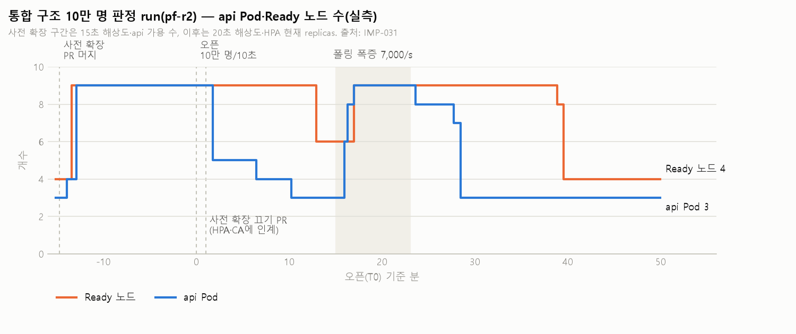
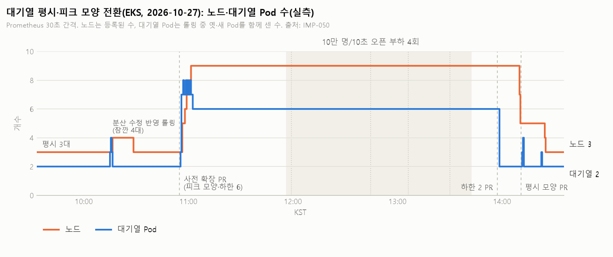
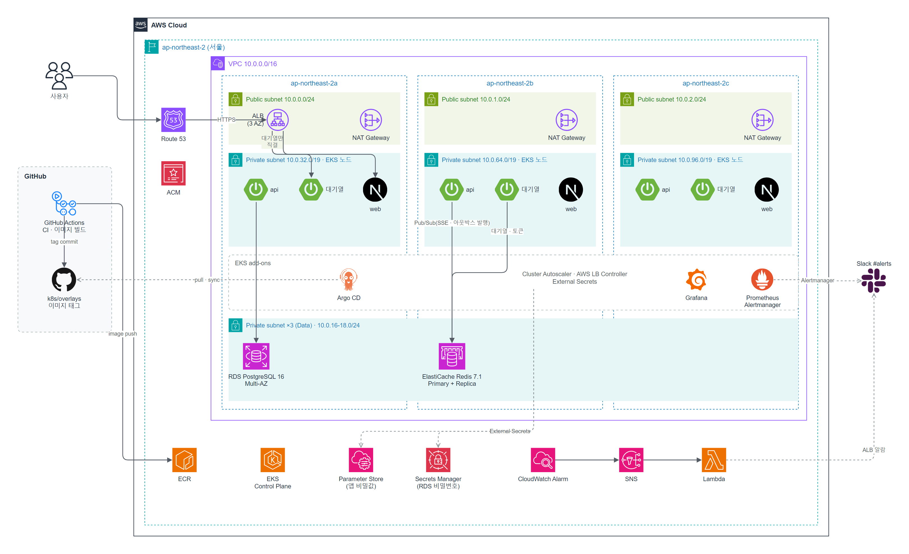

# FlowTicket

선착순 공연 예매 시스템입니다. 대기열, 좌석 선점, 주문, 결제, 환불까지 예매 흐름 전체를 구현했고, AWS EKS에 배포해 대규모 진입 부하와 장애 상황에서의 동작을 측정했습니다.

## 프로젝트 배경

SI 프로젝트에서 요구사항에 맞춰 기능을 구현해 왔지만, 그 기능이 많은 트래픽 속에서도 올바르게 동작하는지 직접 확인할 기회는 적었습니다. 선착순 예매는 정원보다 많은 사용자가 입장하거나 같은 좌석이 두 번 팔리는 문제가 화면만으로는 잘 드러나지 않는 도메인입니다. 그래서 동시성 문제를 막는 구현부터 시작했고, AWS에 직접 배포해 부하·배포·자동 확장·장애 상황에서 정합성이 유지되는지 측정했습니다. 진입 요청 수는 부하 도구의 전송 기록 대신 서버가 실제로 받은 요청을 기준으로 집계했습니다.

## 주요 결과

| 항목 | 결과 | 근거 |
|---|---|---|
| 동시성 정합성 | 입장자 100명이 동시에 좌석 선점·주문·결제(같은 좌석 경합, 중복 클릭, 결제 실패 후 재시도, 1인 한도 포함)를 수행해 판정 3회 모두 정합성 위반 0건 | [IMP-030](docs/improvements/IMP-030-booking-e2e-correctness.md) |
| 10만 명 / 10초 진입 | ALB access log 기준 서버가 받은 진입 요청 100,000건을 모두 정상 처리, 정원 초과·정합성 위반 0건 (통합 구조 3회, 대기열 분리 구조 1회) | [IMP-031](docs/improvements/IMP-031-integrated-platform-100k.md) · [IMP-035](docs/improvements/IMP-035-b-config-100k-entry.md) |
| 평시 노드 5 → 3대 | 대기열 분리로 평시 노드가 5대로 늘어(통합 구조 4대) 비용을 줄일 방법을 찾음. 평시에는 대기열 Pod가 거의 일하지 않아 대기열과 예매 api의 CPU 요청량을 평시 기준(200m)으로 낮추고 한 노드에 같이 두어 평시를 3대로 줄임. 오픈 전에는 PR로 대기열만 측정한 구성(1100m, api와 다른 노드)으로 바꿈. EKS에서 평시 3대, 사전 확장 6분 26초에 9대, 되돌림 두 단계 뒤 다시 3대 확인. 평시를 상시 운영한다고 가정하면 노드 EC2 월 약 $170 절감(분리 직후 5대 대비, 통합 구조 4대 대비로는 약 $85, 계산) | [IMP-050](docs/improvements/IMP-050-queue-peak-shape-cluster-verification.md) · [ADR-031](docs/decisions/ADR-031-queue-peace-peak-shape.md) |
| 자동 확장 | 폴링이 몰리자 Pod 3→9, Node 6→9로 확장한 뒤 부하가 끝나고 다시 축소. 노드 9대 고정 운영 대비 노드-시간 11~13% 절감 (계산) | [IMP-031](docs/improvements/IMP-031-integrated-platform-100k.md) · [IMP-032](docs/improvements/IMP-032-autoscaling-node-hours.md) |
| 무중단 배포·장애 대응 | 롤링 배포 중 5xx 0건(web `preStop` 25s), RDS·Redis Multi-AZ 페일오버에서 파드 재시작 없이 자동 복구 | [TS-035](docs/troubleshooting/TS-035-rolling-deregistration-race.md) · [TS-037](docs/troubleshooting/TS-037-rds-redis-failover-app-behavior.md) |
| 비용 분석 | 측정 세션 비용을 항목별로 분해(평시 5대 기준 시간당 약 $2.06, 계산)해 비용을 줄일 우선순위를 정함 | [IMP-040](docs/improvements/IMP-040-session-cost-breakdown.md) |

## 서비스 흐름

```text
공연 탐색 → 대기열 진입 → 입장 허용 → 좌석 선점 → 주문 생성 → 결제 → 예매 내역 / 환불
```

운영자는 공연·좌석을 관리하고 주문·아웃박스·알림 상태를 확인합니다. 공연 기본 정보는 KOPIS OpenAPI를 백엔드 배치로 동기화하고, 거래에 필요한 좌석·가격·재고는 FlowTicket이 직접 관리합니다.

## 부하·장애 검증

### 10만 명 / 10초 진입과 자동 확장

진입 요청 수는 ALB access log에 기록된 서버 도착 시각으로 10초 구간 안의 요청을 세어 판정했습니다.

공연 오픈 전에 Git PR로 Pod를 미리 늘리고, 오픈 직후 HPA·Cluster Autoscaler에 확장을 넘긴 뒤, 대기자 폴링이 몰릴 때 Pod와 Node가 다시 늘었다가 줄어드는 흐름을 한 번의 실행 안에서 이어서 확인했습니다. 3회 반복해 모두 진입 100,000건을 정상 처리했고 정원 초과·정합성 위반은 없었습니다([IMP-031](docs/improvements/IMP-031-integrated-platform-100k.md)).

<picture>
  <source media="(prefers-color-scheme: dark)" srcset="docs/assets/scaling-pf-r2-dark.png">
  
</picture>

<sub>출처: IMP-031 pf-r2 측정 데이터. 데이터 [`imp031-pf-r2-scaling.csv`](docs/assets/imp031-pf-r2-scaling.csv), 생성 스크립트 [`scaling-chart.py`](docs/assets/scaling-chart.py)</sub>

운영 구성을 대기열 분리 구조로 바꾼 뒤에는 진입을 받는 Pod가 api 9개에서 대기열 6개로 달라졌기 때문에, 같은 판정 기준으로 다시 측정했습니다. 진입 100,000건을 모두 정상 처리했고 정원 초과·정합성 위반은 없었습니다([IMP-035](docs/improvements/IMP-035-b-config-100k-entry.md)).

### 대기열 전용 Deployment 분리

폴링이 몰리면 대기열 요청과 예매 요청이 같은 Pod에서 함께 처리되면서 스레드를 나눠 쓰게 됩니다. 이를 줄이기 위해 코드를 서비스로 나누는 대신 같은 이미지로 대기열 전용 Deployment를 추가했습니다(overlay `components:` 설정으로 대기열 Service의 대상을 변경). 같은 Pod 예산(9개)에서 기존 통합 구조와 비교했습니다.

비교 전에 판정 지표(폭증 중 예매 p95 ÷ 폭증 전 예매 p95)와 기준을 먼저 정했고, 두 구조 모두 같은 절차(시작 Pod 워밍업, 폭증 대비 예매 시점 고정)로 2회씩 측정했습니다.

| 지표 (구조별 2회) | 통합 구조 | 대기열 전용 Deployment |
|---|---|---|
| 폭증 중 예매 p95 (선점·주문·결제) | 1.6~2.6초 | 184~272ms |
| 노드 비용 (계산, run 25분) | $0.32 | $0.37~0.41 |

통합 구조에서는 폭증으로 새로 생성된 Pod가 예매 요청의 약 61%를 받았고, 이 Pod들의 처리 시간이 기존 Pod보다 길었습니다. 분리 구조는 예매 Pod 수가 고정되어 이 영향을 받지 않습니다. 노드 비용이 늘어나는 것을 감안하고, 예매 응답 시간을 지키는 쪽을 택해 분리 구조를 운영 기본값으로 정했습니다([IMP-033](docs/improvements/IMP-033-queue-split-ab.md) · [ADR-027](docs/decisions/ADR-027-queue-dedicated-deployment.md)).

분리 뒤 평시 노드는 통합 구조의 4대([IMP-032](docs/improvements/IMP-032-autoscaling-node-hours.md))에서 5대로 늘었습니다(CPU 요청량 1100m인 api 3개와 대기열 2개가 노드를 하나씩 사용). 평시에는 열린 대기열이 없어 대기열 Pod가 거의 일하지 않기 때문에(CPU 0.01~0.02코어), 대기열과 예매 api의 CPU 요청량을 평시 기준(200m)으로 낮추고 한 노드에 같이 두어 평시 노드를 3대로 줄였습니다. 오픈 전에는 PR로 대기열을 측정한 구성(1100m, api와 다른 노드)으로 바꿉니다([ADR-031](docs/decisions/ADR-031-queue-peace-peak-shape.md) · [IMP-050](docs/improvements/IMP-050-queue-peak-shape-cluster-verification.md)).

### 롤링 배포 중 502 해결

롤링 배포 중 502가 발생해 ALB 지표를 분석했습니다. 실패 요청의 지연이 정확히 `10,000ms`에 몰려 있었고 `Target_5XX`는 0이어서 애플리케이션 오류는 아니었습니다. 원인은 파드가 응답을 멈춘 뒤에도 ALB가 해당 타깃을 정상으로 보고 요청을 보내던 구간이었습니다.

일반적으로 쓰는 `deregistration_delay` 조정 대신, ALB가 타깃을 해제할 때까지 컨테이너가 요청을 계속 처리하도록 `preStop` 대기 시간을 늘려 해결했습니다.

| 조건 | 요청 | 5xx |
|---|---|---|
| `preStop` 5s | 6,001 | 발생 |
| `preStop` 25s | 6,001 | 0 |

([TS-035](docs/troubleshooting/TS-035-rolling-deregistration-race.md) · [IMP-015](docs/improvements/IMP-015-rolling-zero-downtime.md))

### 로컬·시뮬레이션으로 정하고 클러스터에서 확인

설정값 후보는 클러스터를 띄우지 않고 두 가지 방법으로 좁혔고, 고른 안은 클러스터 세션에서 다시 쟀습니다.

- **kwok 스케줄링 시뮬레이션**: 실제 kube-scheduler에 가짜 노드를 붙이고, 실제 클러스터 스냅샷(시스템 Pod·데몬셋·노드 명세)과 당시 매니페스트를 올려 요청량을 바꿨을 때의 평시·사전 확장 노드 수를 계산했습니다. 시뮬레이션에 앞서 당시 구성에서 실제 클러스터와 같은 노드 수(평시 5대, 사전 확장 9대)가 나오는 것을 확인했습니다.
- **로컬 코어 고정 실험**: 같은 이미지 컨테이너를 노드 크기(코어 2개)에 고정하고 조건을 하나씩 바꿔 비교했습니다. 판정 기준은 측정 전에 정했고, api·대기열 동거 비교([IMP-038](docs/improvements/IMP-038-api-queue-colocation-contention.md))부터는 측정 순서를 교차하거나 배정을 맞바꿔 환경 차이를 줄였습니다. 예매 묶음은 PostgreSQL WAL 동기화 지연을 함께 기록해, 저장 장치가 느렸던 묶음은 무효로 두고 다시 쟀습니다([IMP-043](docs/improvements/IMP-043-booking-burst-connection-wait-cause.md)).

| 질문 | 방법 | 결과 | 결정 |
|---|---|---|---|
| Tomcat 스레드를 늘리면 나아지는가 | 로컬, Redis만 느리게 한 조건 | 200 → 400에서 처리 성능 개선 없음 | 200 유지 ([IMP-036](docs/improvements/IMP-036-local-threads-and-booking-burst.md)) |
| 예매 api CPU 요청량을 낮춰 노드를 줄일 수 있는가 | kwok + 로컬 | 300m로 낮추면 평시 5 → 4대지만, 줄어든 1대는 api와 대기열이 한 노드를 나눠 쓰는 배치였고 오픈 부하(폴링 3,000/s + 예매 묶음)에서 예매 p95가 41~87% 늘고 대기열 Tomcat 스레드가 200으로 포화됨 | 그때는 1100m 유지 ([IMP-037](docs/improvements/IMP-037-node-consolidation-scheduling-sim.md) · [IMP-038](docs/improvements/IMP-038-api-queue-colocation-contention.md)) |
| api와 대기열을 같은 노드에 두지 않는 규칙 | kwok(실제 스케줄러) | 당시 요청량에서는 노드 수 변화 없음(평시 5, 사전 확장 9). api 요청량을 300m로 낮춘 조건에서도 api·대기열이 한 노드에 놓이지 않음 | 대기열 Pod에 api Pod 회피 규칙 적용 ([IMP-047](docs/improvements/IMP-047-queue-api-anti-affinity-sim.md)) |
| 예매 api 요청량을 낮춰 평시 노드를 줄이면 | 로컬(가정 평시 조회) + kwok | 평시 조회에서 예매 api Pod당 CPU 평균 0.07~0.39코어. 요청량 후보 800m로는 평시 노드가 5대로 그대로였고, 평시 기준 200m는 평시 4대지만 오픈 순간에 api와 대기열이 한 노드에 놓임 | 그때는 1100m 유지. 평시 기준 200m는 아래 모양 전환에서 사용 ([IMP-048](docs/improvements/IMP-048-booking-api-requests-review.md)) |
| 평시에만 합치고 오픈 전에 떼면 | kwok으로 평시 → 사전 확장 → 축소 한 바퀴 + 로컬 | api 변경을 먼저 끝내면 롤링이 노드 상한에 막히지 않음. 평시 가정 부하(폴링 300/s)에서 동거 시 예매 p95가 늘었고, 1,000/s에서는 판정이 갈림 | 채택 보류 ([IMP-039](docs/improvements/IMP-039-peace-consolidate-open-separate.md)) |
| 평시 예매 api를 2개로 줄이면 | kwok + 로컬 | 평시 4대가 되는 경우와 5대가 남는 경우로 갈림 | 3개 유지 ([IMP-041](docs/improvements/IMP-041-peace-api-two.md)) |
| 평시에는 대기열을 작게 두고 오픈 전에 피크 모양으로 바꾸면 | kwok으로 평시 → 사전 확장 → 피크 중 축소 → 되돌림 한 바퀴(적용 순서 3가지 × 2회) + 로컬 | 평시 3대, 사전 확장 9대(동거 0), 되돌린 뒤 3대. 예매 api와 대기열을 노드마다 하나로 두는 분산 규칙 두 개가 필요했음. 로컬 평시 동거의 예매·조회 p95 차이는 4쌍 모두 30% 안 | 적용, 평시 노드 5 → 3대(평시 상시 운영 가정 월 약 $170, 계산) ([IMP-049](docs/improvements/IMP-049-queue-peace-peak-shape.md) · [ADR-031](docs/decisions/ADR-031-queue-peace-peak-shape.md)) |
| 그 전환을 실제 클러스터에서 돌리면 | EKS, 사전 등록 V1~V7 + 10만 명/10초 오픈 부하 4회 | 평시 3대, 사전 확장 6분 26초에 9대(동거 0), 되돌림 두 단계 각각 12분 32초(5대)·13분 51초(3대). 오픈 부하 4회 모두 진입·정합성 위반 0. 피크 예매 api 요청량별 예매 p95는 200m 436.8~496.5ms, 1100m 310.7~317.8ms | 전환 절차 확인. 피크 예매 api 요청량과 평시 동거는 다음 측정 대상 ([IMP-050](docs/improvements/IMP-050-queue-peak-shape-cluster-verification.md) · [ADR-031](docs/decisions/ADR-031-queue-peace-peak-shape.md)) |
| 예매 순간 DB 풀을 늘리면 | 로컬, 디스크 지연 묶음을 걸러낸 교차 8묶음 | 4쌍 중 3쌍이 ±20% 안. 풀 8은 커넥션마다 점유가 길어져 처리량이 비슷함(계산) | 5 유지 ([IMP-042](docs/improvements/IMP-042-booking-db-pool-5-vs-8.md) · [IMP-043](docs/improvements/IMP-043-booking-burst-connection-wait-cause.md)) |
| 장애 초기 원인 분석에 AI를 쓰면 | 로컬 장애 주입(Redis·DB·CPU, 정상), 규칙 분류기와 Claude Haiku 5.5를 같은 요약으로 채점 | 1차 23회: 장애 정답 규칙 13/17, AI 11/17(CPU 0/6). 요약에 CPU 할당량에 막힌 주기 비율을 넣은 2차 22회: 규칙 15/16, AI 16/16(CPU 6/6), 정상 오탐 규칙 0·AI 1. 호출당 약 $0.002 | 원인 판정은 규칙, AI는 근거·반대 지표·확인 항목 정리 ([IMP-044](docs/improvements/IMP-044-triage-rule-vs-ai-eval.md) · [IMP-045](docs/improvements/IMP-045-triage-eval-cpu-throttling.md) · [ADR-029](docs/decisions/ADR-029-ai-triage-boundary.md)) |

고른 안인 대기열 평시·피크 모양 전환은 EKS에서 평시, 사전 확장, 오픈 부하, 되돌림을 한 세션 안에서 이어서 측정했습니다([IMP-050](docs/improvements/IMP-050-queue-peak-shape-cluster-verification.md)).

<picture>
  <source media="(prefers-color-scheme: dark)" srcset="docs/assets/qpeak-cycle-dark.png">
  
</picture>

<sub>출처: IMP-050 측정 세션의 Prometheus 내보내기. 데이터 [`imp050-qpeak-nodes.csv`](docs/assets/imp050-qpeak-nodes.csv), 생성 스크립트 [`qpeak-chart.py`](docs/assets/qpeak-chart.py)</sub>

### 정합성을 지키는 방법

| 단계 | 목적 | 방법 |
|---|---|---|
| **코드** | 동시성 정합성 | Redis Lua로 대기열 승격을 원자적으로 처리, 좌석·주문은 조건부 `UPDATE`와 영향 행 수 검증, 이벤트는 Transactional Outbox |
| **CI** | 구조 이탈 방지 | 계약(enum·API·이벤트·계층)을 파일로 관리하고 정적 검사. 일부러 만든 위반 fixture 87개로 검사 규칙이 실제로 위반을 잡는지 메타테스트로 확인 |
| **측정** | 운영 환경의 장애·부하 | 클러스터에 장애를 주입하고 부하를 걸어 동작 확인. 롤링 배포, 노드 오토스케일([IMP-021](docs/improvements/IMP-021-cluster-autoscaler-node-scaling.md)), RDS/Redis 페일오버([TS-037](docs/troubleshooting/TS-037-rds-redis-failover-app-behavior.md)), 10만 명 / 10초 진입([IMP-031](docs/improvements/IMP-031-integrated-platform-100k.md) · [IMP-035](docs/improvements/IMP-035-b-config-100k-entry.md)), 대기열 평시·피크 모양 전환([IMP-050](docs/improvements/IMP-050-queue-peak-shape-cluster-verification.md)) |

## 검증 결과 전체

| 검증 | 결과 | 근거 |
|---|---|---|
| 대기열 진입 10만 명 / 10초 + 자동 확장 | 3회 모두 진입 100,000건 정상 처리, 정원 초과·정합성 위반 0건. 폴링 폭증에 Pod 3→9, Node 6→9로 확장 후 축소 | [IMP-031](docs/improvements/IMP-031-integrated-platform-100k.md) |
| 대기열 분리 구조의 10만 명 / 10초 | 오픈 전 Git PR로 대기열 Pod 2→6, 진입 100,000건 정상 처리(진입 p95 46ms, 대기 상태 조회 p95 8ms, 서버 처리 시간), 정원 초과·정합성 위반 0건. 오픈 뒤 HPA로 넘겨 대기열 6→2, Node 9→7 축소 | [IMP-035](docs/improvements/IMP-035-b-config-100k-entry.md) |
| 대기열 평시·피크 모양 전환 (EKS) | 평시 3대(16분 유지), 사전 확장 PR 반영부터 6분 26초에 노드 9대·api와 대기열 동거 0, 피크 동안 노드 9 유지, 되돌림 두 단계 각각 12분 32초(5대)·13분 51초(3대). 피크 구성의 10만 명 / 10초 오픈 부하 4회 모두 도착 누락 0·정합성 위반 0 | [IMP-050](docs/improvements/IMP-050-queue-peak-shape-cluster-verification.md) · [ADR-031](docs/decisions/ADR-031-queue-peace-peak-shape.md) |
| 자동 확장 비용 효과 | 통합 구조 측정 run의 실제 노드 수 변화를 시간으로 적분해, 노드 9대 고정 대비 노드-시간 11~13% 절감 (계산) | [IMP-032](docs/improvements/IMP-032-autoscaling-node-hours.md) |
| 대기열 분리 비교 (같은 Pod 예산 9) | 폴링 폭증(7,000/s) 중 예매 p95: 통합 1.6~2.6초, 분리 184~272ms (각 2회, 오류·정합성 위반 0건) | [IMP-033](docs/improvements/IMP-033-queue-split-ab.md) · [ADR-027](docs/decisions/ADR-027-queue-dedicated-deployment.md) |
| 입장자 동시 예매 | 입장자 100명이 동시에 좌석 선점·주문·결제, 3회 모두 정합성 위반 0건 | [IMP-030](docs/improvements/IMP-030-booking-e2e-correctness.md) |
| 무중단 배포 | 롤링 배포 중 5xx 0건 (web `preStop` 25s) | [TS-035](docs/troubleshooting/TS-035-rolling-deregistration-race.md) · [IMP-015](docs/improvements/IMP-015-rolling-zero-downtime.md) |
| 장애 주입 | RDS·Redis Multi-AZ 페일오버에서 파드 재시작 없이 자동 복구, 노드 오토스케일로 Pending 파드 수용 | [TS-037](docs/troubleshooting/TS-037-rds-redis-failover-app-behavior.md) · [IMP-021](docs/improvements/IMP-021-cluster-autoscaler-node-scaling.md) |
| Redis 장애 중 조회 | 로컬에서 Redis를 멈춰 확인. readiness에서 Redis를 빼고 Redis 명령 상한을 60초에서 2초로 줄여, 공연 상세·내 주문이 60초에서 약 2초로 응답하고 대기열 진입·좌석 선점은 약 4초 뒤 503으로 응답(1회 측정). 대기열 Pod는 readiness에 Redis를 남겨 장애 중 Service에서 빠지게 함 | [IMP-046](docs/improvements/IMP-046-redis-outage-readiness.md) · [ADR-030](docs/decisions/ADR-030-readiness-shared-dependencies.md) |
| 대기열 토큰 정합성 | 토큰 소유권 검증, 재발급·이탈 경합(1인 1토큰), 대기 토큰 수명 관리를 통합 테스트로 검증 | [TS-043](docs/troubleshooting/TS-043-queue-token-ownership.md) · [TS-044](docs/troubleshooting/TS-044-queue-takeover-leave-race.md) · [TS-045](docs/troubleshooting/TS-045-queue-token-lifecycle.md) |
| 설정값 근거 재검토 | CPU 요청량, Tomcat 스레드, DB 풀, 노드 수의 근거를 측정 원자료 재분석, 로컬 실험, kwok 스케줄링 시뮬레이션으로 확인. Tomcat 스레드는 400으로 늘려도 효과가 없어 200 유지, 평시 노드 수는 후보 3가지를 검토한 뒤 대기열 평시·피크 모양 전환으로 5대에서 3대로 줄이고 EKS에서 확인, 예매 api DB 풀은 5 유지 | [IMP-036](docs/improvements/IMP-036-local-threads-and-booking-burst.md)~[IMP-039](docs/improvements/IMP-039-peace-consolidate-open-separate.md) · [IMP-041](docs/improvements/IMP-041-peace-api-two.md) · [IMP-049](docs/improvements/IMP-049-queue-peace-peak-shape.md) · [IMP-050](docs/improvements/IMP-050-queue-peak-shape-cluster-verification.md) · [IMP-042](docs/improvements/IMP-042-booking-db-pool-5-vs-8.md) · [IMP-043](docs/improvements/IMP-043-booking-burst-connection-wait-cause.md) |
| 측정 세션 비용 분해 | 평시 노드 5대, 부하 발생기 3대 기준 세션 시간당 약 $2.06 (계산). 비중은 노드 29%, 발생기 28%, Redis 19%, NAT 9% | [IMP-040](docs/improvements/IMP-040-session-cost-breakdown.md) |

### 측정 환경

| 측정 | 날짜 | 노드 | Redis | RDS | Kafka | 부하 발생기 | api 이미지 | 횟수 |
|---|---|---|---|---|---|---|---|---|
| [IMP-030](docs/improvements/IMP-030-booking-e2e-correctness.md) 입장자 동시 예매 | 2026-10-07 | m6i.large (측정 시 3대) | cache.t4g.micro × 2 | db.t4g.micro Multi-AZ | 사용 | k6, EC2 c6i.xlarge × 1 | `d14e36b` | 3회 |
| [IMP-031](docs/improvements/IMP-031-integrated-platform-100k.md) 통합 구조 10만 + 자동 확장 | 2026-10-08 | m6i.large (AZ당 최대 3, 합 9) | cache.t4g.micro × 2 | db.t4g.micro Multi-AZ | 사용 | k6, EC2 c6i.xlarge × 3 | `419c96b` | 3회 |
| [IMP-033](docs/improvements/IMP-033-queue-split-ab.md) 대기열 분리 비교 | 2026-10-14 | m6i.large (AZ당 최대 3) | cache.m7g.large × 2 | db.t4g.micro Multi-AZ | 사용 | k6, EC2 c6i.xlarge × 3 | `2f1f7ff` | 구조별 2회 |
| [IMP-035](docs/improvements/IMP-035-b-config-100k-entry.md) 대기열 분리 구조 10만 | 2026-10-17 | m6i.large (AZ당 최대 3, 합 9) | cache.m7g.large × 2 | db.t4g.micro Multi-AZ | 제거 후 | k6, EC2 c6i.xlarge × 3 | `9ad3494` | 1회 |
| [IMP-050](docs/improvements/IMP-050-queue-peak-shape-cluster-verification.md) 대기열 평시·피크 모양 전환 | 2026-10-27 | m6i.large (AZ당 최대 3, 평시 3·피크 9) | cache.m7g.large × 2 | db.t4g.micro Multi-AZ | 제거 후 | k6, EC2 c6i.xlarge × 3 | `fa09c33` | 단계 V1~V7, 오픈 부하 4회 |

## 설계 결정

| 선택 | 비교한 대안 | 선택 이유 | 근거 |
|---|---|---|---|
| 같은 이미지의 대기열 전용 Deployment | 통합 구조 유지, 서비스 분리 | 폭증 중 예매 p95가 통합 구조 1.6~2.6초, 분리 구조 184~272ms(각 2회). 노드 비용 증가(+15~28%, 계산)를 감안하고 선택 | [ADR-027](docs/decisions/ADR-027-queue-dedicated-deployment.md) · [IMP-033](docs/improvements/IMP-033-queue-split-ab.md) |
| 대기열 상태는 폴링(`retryAfterMs`) | 대기열 SSE | 대기자 전원의 SSE 연결은 Pod 메모리 1Gi에서 약 3,300~3,500개 시점에 OOM이 발생 | [ADR-023](docs/decisions/ADR-023-burst-entry-and-waiting-two-axes.md) |
| Outbox + Redis Pub/Sub | Kafka | 아웃박스 이벤트가 `order.paid` 하나뿐이어서 브로커 3대를 운영할 필요가 없다고 판단 | [ADR-028](docs/decisions/ADR-028-kafka-reevaluation.md) |
| `preStop` 25s | `deregistration_delay` 조정 | 실패가 타깃 해제 이전 구간에서 발생했고 애플리케이션 5xx는 0건 | [TS-035](docs/troubleshooting/TS-035-rolling-deregistration-race.md) |
| readiness는 예매 api DB만, 대기열 DB·Redis | 기존(DB·Redis 모두), 둘 다 제외 | Redis는 모든 Pod가 함께 써서 넣으면 장애 중 조회까지 끊김. 대기열은 Redis 없이 처리할 수 없어 장애 중 빠지는 편이 요청 스레드를 묶지 않음 | [ADR-030](docs/decisions/ADR-030-readiness-shared-dependencies.md) · [IMP-046](docs/improvements/IMP-046-redis-outage-readiness.md) |
| AZ별 NAT 3개 | NAT 1개 | NAT를 하나만 두면 그 AZ 장애가 다른 AZ의 결제 호출까지 막음 | [ADR-012](docs/decisions/ADR-012-3az-eks-infra-cost-control.md) |
| Tomcat 스레드 200 | 400 | 하위 의존성이 느린 조건에서 400으로 늘려도 처리 성능이 개선되지 않음 | [IMP-036](docs/improvements/IMP-036-local-threads-and-booking-burst.md) |
| 평시 노드 3대(대기열 평시·피크 모양 전환) | 평시 5대 유지, CPU 요청량만 축소, 평시 api 2개, Deployment 두 개, 작은 Pod 개수 늘리기 | 오픈 순간 대기열은 측정한 구성(1100m·api와 다른 노드) 그대로이고, 평시 3대 → 사전 확장 9대(6분 26초) → 평시 3대 전환을 EKS에서 확인. Deployment 두 개는 HPA가 0개로 줄지 않고, 작은 Pod를 늘리면 DB 커넥션 예산을 넘음 | [ADR-031](docs/decisions/ADR-031-queue-peace-peak-shape.md) · [IMP-049](docs/improvements/IMP-049-queue-peace-peak-shape.md) · [IMP-050](docs/improvements/IMP-050-queue-peak-shape-cluster-verification.md) · [IMP-038](docs/improvements/IMP-038-api-queue-colocation-contention.md) |
| CA 축소 대기 10분 | 5분 | 5분으로 줄이면 run당 약 $0.08 절감되지만 폭증 직전의 여유 노드가 먼저 제거됨(계산) | [IMP-032](docs/improvements/IMP-032-autoscaling-node-hours.md) §10 |

## 핵심 설계

- **대기열**: Redis Lua 스크립트로 토큰 발급과 입장 승격을 원자적으로 처리합니다. 좌석 선점과 이탈은 토큰을 발급받은 회원만 할 수 있고, 대기 토큰은 폴링하는 동안 수명이 연장됩니다.
- **좌석과 주문**: PostgreSQL 조건부 `UPDATE`와 영향 행 수 검증으로 중복 선점과 초과판매를 막습니다.
- **결제 상태 전이**: 주문·결제·좌석·hold 상태를 명시적으로 전이하고 멱등성 키를 사용합니다.
- **이벤트 전달**: 비즈니스 트랜잭션과 Outbox 기록을 함께 저장하고, 릴레이가 Redis Pub/Sub(`sse:order`)으로 발행해 SSE로 전달합니다.
- **실시간 반영**: 대기열은 서버가 다음 조회 시점(`retryAfterMs`)을 정하는 폴링으로, 좌석·주문 상태는 SSE와 재조회로 화면에 반영합니다.
- **용량과 확장**: CPU 요청량 1100m는 진입 요청 1건당 처리 비용 측정값으로 계산했고([ADR-025](docs/decisions/ADR-025-api-requests-hpa-policy.md)), 오픈 순간에 진입을 받는 대기열의 피크 모양에 씁니다. 예매 api는 평시·피크 모두 200m(평시 조회 실측, [IMP-048](docs/improvements/IMP-048-booking-api-requests-review.md))이고, 대기열은 평시에 열린 대기열이 없어 200m로 두었다가 오픈 전 사전 확장 PR에서 피크 모양으로 바꿉니다([ADR-031](docs/decisions/ADR-031-queue-peace-peak-shape.md), [설정값 근거](docs/deployment/optimization-targets.md)). HPA와 Cluster Autoscaler로 Pod와 Node를 늘리고 줄이며(api 3개 고정, 대기열 2~6개), 대기열 Pod가 늘기 시작하는 데 40~70초, 노드 추가에 100~150초가 걸리기 때문에 공연 오픈 전에는 Git PR로 대기열을 2개에서 6개로 미리 늘립니다. 이 사전 확장은 EKS에서 PR 반영부터 6분 26초에 끝났습니다([IMP-050](docs/improvements/IMP-050-queue-peak-shape-cluster-verification.md)).
- **외부 데이터 분리**: KOPIS 호출은 요청 경로와 분리해 배치 동기화로 처리합니다.

## 백엔드 아키텍처

백엔드는 Controller → Service → Repository/Gateway 계층으로 구성됩니다. 대기열·좌석·결제처럼 정합성이 중요한 도메인은 상태 조건을 포함한 명시적 전이로 처리합니다.

| 영역 | 책임 | 주요 구성 |
|---|---|---|
| 인증 | 회원가입, 로그인, 토큰 재발급, 소셜 로그인 | JWT Access/Refresh, Redis rotation, Kakao/Naver OAuth2 |
| 공연 | KOPIS 동기화, 검색, 상세, 인기 지표 | 스케줄 기반 동기화 작업, PostgreSQL |
| 대기열 | 발급, 순번 조회, 입장 승격, 만료 | Redis, Lua, 폴링(`retryAfterMs`) |
| 예매 | 좌석 hold, 주문, 결제, 환불 | JPA, QueryDSL, 조건부 UPDATE, 멱등성 |
| 이벤트 | 주문 완료 이벤트와 실패 격리 | Transactional Outbox, Redis Pub/Sub |
| 운영 | 공연, 주문, 아웃박스, 알림 관리 | Spring Security RBAC, 관리자 API |

## 인프라 아키텍처



<sub>원본: [`docs/assets/architecture-infra.drawio`](docs/assets/architecture-infra.drawio) (diagrams.net에서 편집 가능)</sub>

배포는 GitOps 방식입니다. CI는 이미지를 ECR에 올리고 매니페스트의 이미지 태그를 Git에 커밋하며(`.github/workflows/image.yml`), 클러스터 반영은 Argo CD가 담당합니다. 인프라는 Terraform, 애플리케이션은 Argo CD가 관리합니다([ADR-009](docs/decisions/ADR-009-gitops-cd-argocd.md)).

- 로컬 개발은 Docker Compose로 PostgreSQL·Redis를 띄우고, 통합 환경(`infra/docker-compose.prod.yml`)은 여기에 API·web을 추가합니다.
- 클러스터는 Kubernetes manifests와 Terraform으로 구성합니다. API에는 health probe, graceful shutdown(`preStop`), HPA(api 3개 고정, 대기열 2~6개)와 Cluster Autoscaler, PDB를 설정했고, web은 사전 확장 때 api·대기열 Pod가 먼저 배치되도록 낮은 PriorityClass를 둡니다.
- 대기열 진입과 상태 조회는 ALB가 Next.js를 거치지 않고 대기열 전용 Pod로 바로 보냅니다([ADR-024](docs/decisions/ADR-024-queue-path-next-hop-bypass.md) · [ADR-027](docs/decisions/ADR-027-queue-dedicated-deployment.md)). 예매하기에서 대기열 화면으로의 이동도 web 서버 렌더링 없이 정적 경로로 처리합니다([TS-053](docs/troubleshooting/TS-053-queue-nav-still-through-web.md)).
- 비밀값은 환경변수와 External Secrets로 주입하며 코드에 저장하지 않습니다.
- 배포·운영 문서는 [docs/deployment](docs/deployment/_index.md)와 [infra](infra)에서 관리합니다.

## 비용

클러스터는 측정할 때만 생성하고 측정이 끝나면 철거합니다. 금액은 서울 리전 공개 가격(온디맨드) 기준 계산값입니다.

| 상태 | 시간당 비용 (계산) | 근거 |
|---|---|---|
| 평시(노드 3대) + 부하 발생기 3대 | 약 $1.82 | [IMP-040](docs/improvements/IMP-040-session-cost-breakdown.md) · [ADR-031](docs/decisions/ADR-031-queue-peace-peak-shape.md) |
| 사전 확장(노드 9대) + 발생기 3대 | 약 $2.55 | [IMP-040](docs/improvements/IMP-040-session-cost-breakdown.md) |
| 평시(노드 3대), 발생기 없음 | 약 $1.22 | [IMP-040](docs/improvements/IMP-040-session-cost-breakdown.md) · [ADR-031](docs/decisions/ADR-031-queue-peace-peak-shape.md) |

IMP-040은 평시 노드 5대 기준으로 분해했습니다(약 $2.06, 노드 29%, 발생기 28%, Redis 19%, NAT 9%). 평시 3대 값은 여기서 노드 2대분(대당 약 $0.121, 디스크 포함)을 뺀 값입니다.

- 자동 확장으로 통합 구조 측정 run에서 노드 9대 고정 대비 노드-시간을 11~13% 줄였습니다(계산, [IMP-032](docs/improvements/IMP-032-autoscaling-node-hours.md)).
- 비용 분해 결과 부하 발생기 비중이 크고 전체 비용이 세션 길이에 비례해서, 발생기 가동 시간과 세션 길이를 우선 관리합니다([IMP-040](docs/improvements/IMP-040-session-cost-breakdown.md)).
- 철거는 `scripts/tear-down.sh`가 Terraform 외부 리소스(Ingress·ALB, EBS, ENI)를 먼저 정리한 뒤 남은 리소스를 점검합니다(`--audit-only`는 점검만 수행). ECR·ACM·Route53·tfstate 같은 bootstrap 리소스는 유지합니다.
- AWS Budgets(월 $50, 4단계 알림)와 Cost Anomaly Detection을 설정했습니다([ADR-012](docs/decisions/ADR-012-3az-eks-infra-cost-control.md)).

## 실행 방법

### 로컬

빌드한 이미지로 PostgreSQL, Redis, API, web 전체를 실행합니다. 첫 빌드에는 몇 분이 걸립니다.

```bash
docker compose -f infra/docker-compose.prod.yml up --build -d
```

KOPIS 키 없이 실행할 때는 판매 중인 공연 1개(좌석 100석)를 시드 데이터로 추가합니다.

```bash
docker compose -f infra/docker-compose.prod.yml exec -T postgres psql -U flowticket -d flowticket < e2e/ci/seed.sql
```

- 브라우저에서 `http://localhost:3000`에 접속합니다(API는 `8080`). 포트가 겹치면 `WEB_PORT`, `API_PORT` 환경변수로 변경합니다.
- 로컬에서는 회원가입 휴대폰 인증이 mock으로 동작하며 고정 코드 `123456`을 입력하면 됩니다(`application.yml`의 `auth.phone`).
- 결제는 기본값인 mock 게이트웨이(`PAYMENT_GATEWAY=mock`)로 동작합니다.
- 종료: `docker compose -f infra/docker-compose.prod.yml down -v`

### AWS

실행 중에는 평시에 시간당 약 $1.2~1.8(발생기 여부에 따라, 계산, [비용](#비용))가 발생합니다. 도메인, ECR, ACM, tfstate 같은 계정별 bootstrap이 먼저 필요합니다([terraform-design.md](docs/deployment/terraform-design.md)). 처음 한 번은 `environments/demo`에 `terraform.tfvars`(관리자 IP)와 `backend.hcl`(state-bootstrap 출력)을 만들고 `terraform init -backend-config=backend.hcl`로 초기화합니다([platform README](infra/terraform/platform/README.md) · [`backend.hcl.example`](infra/terraform/platform/environments/demo/backend.hcl.example)).

```bash
terraform -chdir=infra/terraform/platform/environments/demo apply -var-file=loadtest.tfvars
```

```bash
bash scripts/bring-up.sh
```

```bash
bash scripts/tear-down.sh
```

`bring-up.sh`는 `terraform apply` 이후 절차(AWS Load Balancer Controller, Cluster Autoscaler, kube-prometheus-stack, Argo CD 설치, External Secrets 부트스트랩, 워크로드 배포, Route53 갱신, 데이터 시딩)를 한 번에 실행합니다. 비용이 발생하는 `terraform apply`는 스크립트와 분리해 직접 실행하도록 했습니다.

## 기술 스택

| 영역 | 기술 |
|---|---|
| Backend | Java 17 (Temurin), Spring Boot 3.3.x, Gradle 8, Spring Web, Spring Security, Spring Data JPA, QueryDSL 5 (Jakarta) |
| Data & Messaging | PostgreSQL 16, Flyway, Redis (Lettuce, Pub/Sub), 로컬·CI `7.4` / ElastiCache `7.1` |
| Authentication | JWT Access/Refresh, OAuth2 Client, Kakao·Naver |
| Frontend | Node.js 20 LTS, pnpm 9, Next.js 14.2 App Router, TypeScript 5.5 |
| Frontend State & UI | Tailwind CSS 3.4, shadcn/ui, TanStack Query 5, Zustand 4, React Hook Form 7, Zod 3 |
| Infrastructure | Docker Compose v2, Kubernetes, Terraform, Argo CD, AWS EKS, HPA, Cluster Autoscaler |
| Observability | Prometheus, Grafana (kube-prometheus-stack), ALB access log |
| Verification | JUnit 5, Testcontainers 1.20, Playwright, k6(EC2 분산 부하 발생기 3대), GitHub Actions |

## 저장소 구조

```text
apps/
  api/                 Spring Boot API, Flyway migration, 도메인·인프라 코드
  web/                 Next.js App Router 사용자·운영 화면
assets/screens/        화면 레퍼런스 이미지
contracts/             enum, API, event, error, stack, layer 계약
docs/
  common/              공통 API·레이아웃·디자인 시스템
  rules/               도메인·백엔드·프론트 규칙
  screens/             기능별 구현 목록과 화면 스펙
  decisions/           ADR 설계 결정
  improvements/        IMP 측정 기반 개선 기록
  troubleshooting/     TS 장애·회고 기록
  deployment/          배포·인프라 문서
  testing/             E2E·성능 검증 규칙
e2e/                   Playwright 크리티컬 플로우
harness/               계약·구조 드리프트 정적 검사
infra/                 Docker Compose, Terraform, k6
k8s/                   Kubernetes base, overlay, monitoring, Argo CD
```

## 품질 검증 방식

하네스는 기능 구현이 계약과 규칙에서 벗어나지 않는지 확인하는 정적 검사 도구입니다.

| 단계 | 확인 내용 | 예시 |
|---|---|---|
| 계약 (`contracts/`) | enum·API·이벤트·오류 코드·계층 규칙을 YAML로 관리 | `events.yaml`에 구현됨(`implemented`)으로 선언한 이벤트는 실제 발행 코드가 있어야 통과 |
| 정적 하네스 (`npm run harness:check`) | 계약과 코드·매니페스트·문서의 불일치 | 상태 변경 UPDATE의 `WHERE status` 조건, 파괴적 DDL, `@Autowired` 금지(생성자 주입), SSE 훅의 재동기화 경로, 매니페스트와 앱 설정 |
| 메타테스트 | 하네스가 위반을 실제로 잡는지 | 일부러 만든 위반 fixture 87개가 모두 차단되는지 |
| 단위·통합 테스트 (Testcontainers) | 동시성, 상태 전이, Outbox 정합성 | 실제 PostgreSQL·Redis 컨테이너 사용 |
| 알림 규칙 테스트 (promtool) | 알림이 필요한 상황에서만 울리는지 | 규칙 4개의 양성·음성 케이스 |
| E2E (Playwright, CI 풀스택) | 브라우저와 API 사이 흐름, UI 상태 | 프론트·백엔드 변경 PR에서 실행, 실패 시 trace 업로드 |
| 부하 시험 (k6, 클러스터 세션) | 10만 명 진입·폴링 폭증에서의 정합성 | 판정 기준을 먼저 정하고 실행한 뒤 정합성 검사 |

하네스의 범위와 명령은 [docs/HARNESS.md](docs/HARNESS.md)에 정리했습니다.

## 문서 지도

| 목적 | 문서 |
|---|---|
| 기능별 구현·화면 상태 | [docs/screens/_index.md](docs/screens/_index.md) |
| 도메인 불변식 | [docs/rules/domain-rules.md](docs/rules/domain-rules.md) |
| API·이벤트·enum 계약 | [contracts](contracts) |
| 공통 API·레이아웃·디자인 | [docs/common](docs/common) |
| 설계 결정과 대안 | [docs/decisions](docs/decisions/_index.md) |
| 측정 기반 개선 기록 | [docs/improvements](docs/improvements/_index.md) |
| 10만 명 부하 검증 | [100K 계획서](docs/testing/loadtest-100k-plan.md), [IMP-029](docs/improvements/IMP-029-final-100k-10s-queue.md)~[IMP-031](docs/improvements/IMP-031-integrated-platform-100k.md), [IMP-035](docs/improvements/IMP-035-b-config-100k-entry.md) |
| 대기열 평시·피크 모양 전환 | [ADR-031](docs/decisions/ADR-031-queue-peace-peak-shape.md), [IMP-049](docs/improvements/IMP-049-queue-peace-peak-shape.md), [IMP-050](docs/improvements/IMP-050-queue-peak-shape-cluster-verification.md), [클러스터 검증 계획](docs/testing/queue-peak-shape-cluster-verification.md) |
| 대기열 분리 비교 | [ADR-027](docs/decisions/ADR-027-queue-dedicated-deployment.md), [IMP-033](docs/improvements/IMP-033-queue-split-ab.md) |
| 설정값 근거와 비용 | [optimization-targets.md](docs/deployment/optimization-targets.md), [IMP-040](docs/improvements/IMP-040-session-cost-breakdown.md) |
| 장애 분석과 재발 방지 | [docs/troubleshooting](docs/troubleshooting/_index.md) |
| 배포·E2E·성능 검증 | [docs/deployment](docs/deployment/_index.md), [docs/testing](docs/testing/e2e-rules.md) |

## 작업 원칙

기능 하나를 DB 스키마, API, 프론트 화면, 통합 검증까지 끝낸 뒤 다음 기능으로 넘어갑니다. 대기열·좌석·결제·환불 도메인을 변경할 때는 해당 도메인 규칙과 ADR을 먼저 확인합니다.

상세 작업 규칙은 [AGENTS.md](AGENTS.md), 계약과 하네스 설명은 [docs/HARNESS.md](docs/HARNESS.md)를 참고합니다.
