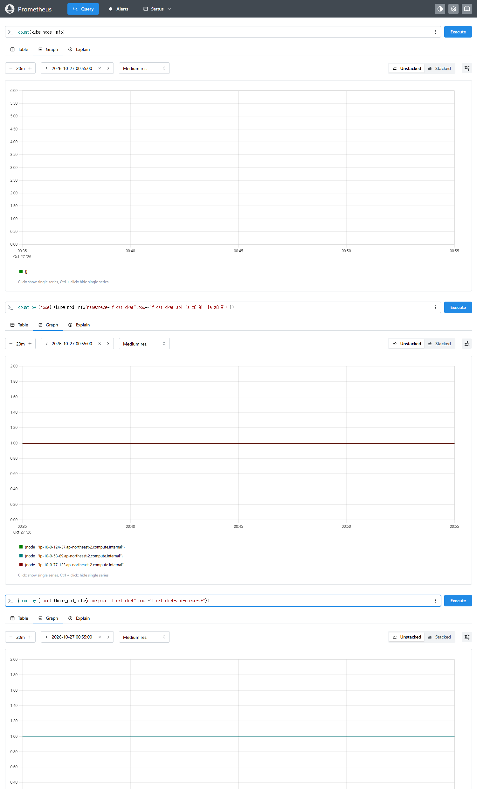
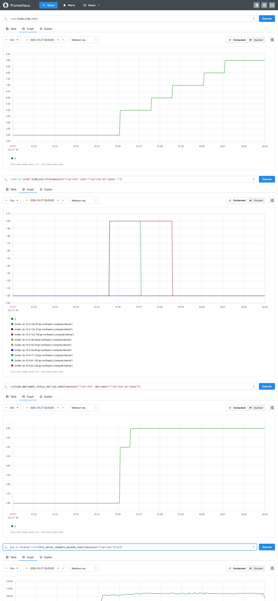
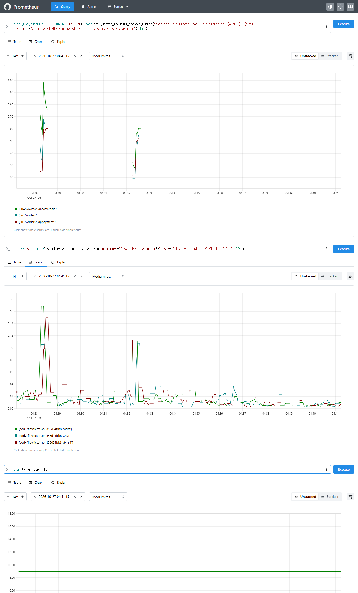
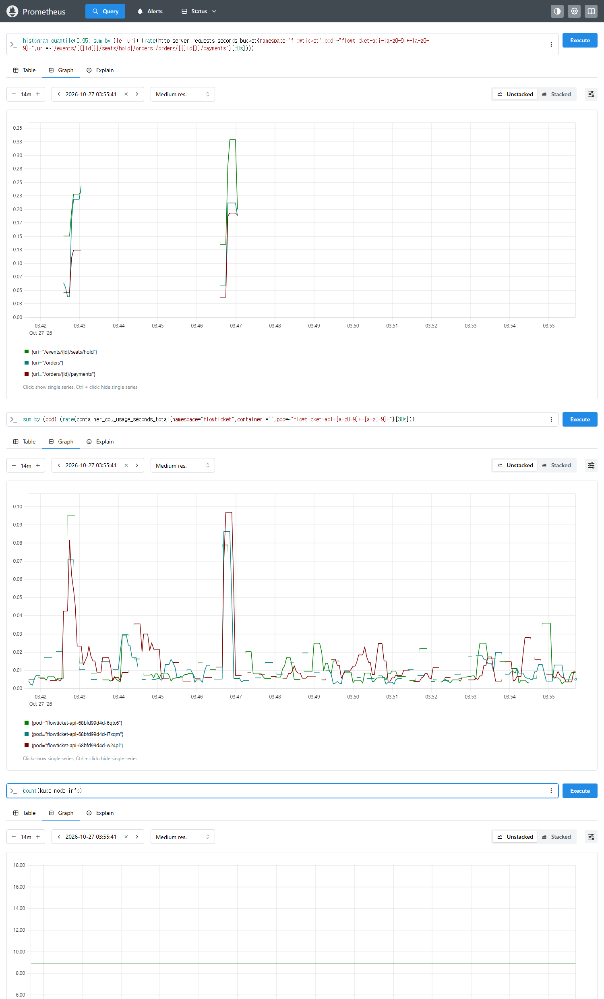
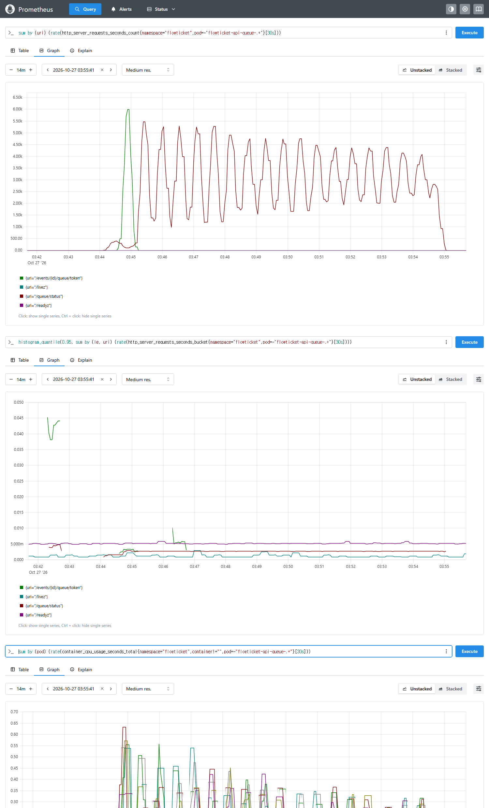
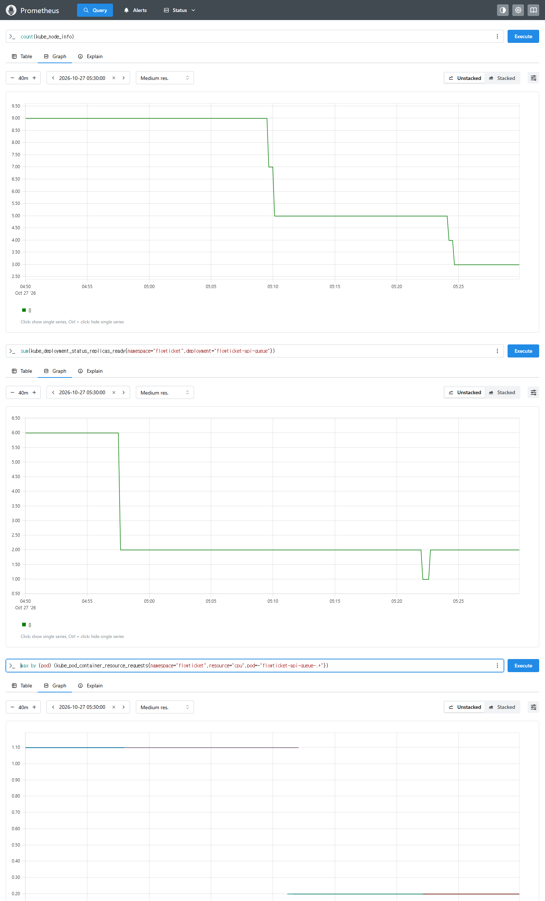

# IMP-050 · 대기열 평시·피크 모양 전환 클러스터 검증: 노드 3 → 9 → 5 → 3 한 바퀴를 EKS에서 재고, 피크의 예매 api 200m는 예매 p95가 1.6배

- 슬라이스: `S10`(부하·확장)
- 날짜: 2026-10-27(측정 세션 `artifacts/loadtest/20261027-qpeak/`, 레포 밖. 시각은 KST, `Z`가 붙은 것만 UTC)
- 유형: 정량(EKS 실측). 판정식은 bring-up 전에 사전 등록했다(`prereg-qpeak.md`, 09:15:14 등록).
- 관련: [[ADR-031]](검증 대상 결정), [[IMP-049]](같은 결정의 kwok·로컬 근거), [[IMP-048]](예매 api 평시 기준 200m), [[IMP-038]](오픈 부하의 동거 경합), [[IMP-035]](B 10만 진입 판정), [[IMP-033]](폭증 중 예매 지연 비교), `docs/testing/queue-peak-shape-cluster-verification.md`(계획)
- 구성: main 8ac42f87(ADR-031 적용) + 세션 중 머지한 PR #472(사전 확장)·#473(분산이 같은 리비전만 세기)·#474(하한 2)·#475(평시 모양), `loadtest.tfvars`(m6i.large AZ당 최대 3대, Redis `cache.m7g.large`, 발생기 c6i.xlarge × 3)
- 벤치 파일: 레포 밖
  - 사전 등록·보충 `prereg-qpeak.md`, 실행 기록 `session.log`·`events.txt`, 후속 `followups.md`
  - run 디렉터리 `V1`~`V7`·`V2b`·`fix-473`·`api-switch-*`, 드라이버 `v2-run.sh`·`v4-run.sh`·`transition.sh`·`api-switch.sh`·`lib.sh`
  - Grafana·Prometheus 화면 `captures/`(이미지 31장: png 26·jpg 5, png는 같은 이름의 `.url.txt`에 조회 URL. 단계별 대표 6장은 레포 `docs/assets/imp050/`에 복사, §4.7), Pod별 메모리 시계열 `memory/`(00:30Z~05:35Z)

## 1. 상황 (Context)
[[ADR-031]]은 대기열 Pod를 평시 모양(200m·api 회피 preferred)으로 두고 오픈 사전 확장 PR에서 피크 모양(1100m·required)으로 바꿔 평시 노드를 5대에서 3대로 줄였다.
근거인 [[IMP-049]]는 배치를 kwok(실제 kube-scheduler, CA는 흉내)으로, 평시 동거를 로컬 상대 비교로 확인했다. 실제 Cluster Autoscaler의 축소, 전환에 걸리는 시간, EKS에서의 평시 동거 영향은 재지 않았다.
또 피크 구성의 예매 api는 측정해 온 구성(1100m)과 달리 200m라서, 그 조건의 오픈 성능도 확인이 필요했다(변경 전 [[ADR-031]] §3 "재지 않았다(추론)").

## 2. 문제 정의 + 분류
- 계층: 스케줄링·자동 확장(배치와 노드 수, 전환 시간) + CPU 공유(평시 동거, 피크 api 노드).
- 질문
  1. 실제 CA가 평시 3대로 줄이고, 피크 중에는 api 노드를 지우지 않는가.
  2. 사전 확장 전환(대기열 롤링 + 노드 추가)이 오픈 전 여유 15분 안에 끝나는가.
  3. 평시 동거의 EKS 결과가 로컬 판정("차이 작음")과 같은 방향인가.
  4. 피크에서 예매 api가 200m일 때 1100m보다 예매가 느린가.

## 3. 측정 방법
- 단계와 판정식(사전 등록 그대로, 결과가 아니라 기준이다):
  - V1 평시 배치: CA 축소가 끝난 뒤 15분 동안 노드 3, api 노드당 1, 대기열 노드당 1, Pending 0.
  - V2 평시 동거: 평시 조회 100 req/s + 예매 묶음 100명, run 3회. Pod별 서버 p95를 예매 URI 묶음과 조회 URI 묶음으로 구해, 대기열과 같은 노드의 api 중 큰 값 ÷ 혼자인 api 값을 본다.
    두 묶음 모두 1.30 미만인 run이 2회 이상이면 "차이 작음", 1.30 이상인 run이 2회 이상이면 "악화 있음".
  - V3 사전 확장 전환: 평시 조회 부하를 건 채 PR #472 머지 → 수동 동기화. 동기화 시작부터 대기열 6 Ready·노드 9 Ready까지 15분 이하, 동거 0, web Ready 1 이상, 조회 5xx 0.
  - V4 오픈 부하: 진입 100,000명 / 10초(발생기 3대) + 대기자 폴링 600초 + 예매 묶음 ①(오픈 전)·②(T0 + 120초). api requests 200m → 1100m → 1100m → 200m 순서.
    진입·대기열은 [[IMP-035]] 6축 그대로. 예매 ② p95(hold·주문·결제 p95의 중앙값) max(200m 2회) ÷ min(1100m 2회)가 1.30 미만이면 "차이 작음", 아니면 "차이 있음".
  - V5 피크 유지: 마지막 V4 run 뒤 노드 9, api 노드당 1 유지.
  - V6 되돌림 1: PR #474(하한 2) 머지 → 동기화. 30분 안에 대기열 2개·노드 5, 동거 0.
  - V7 되돌림 2: 대기자 0 확인 뒤 PR #475(평시 모양) 머지 → 동기화. 30분 안에 노드 3, Pending 0, api 노드당 1.
- run 조건: 전환 시간은 `mergedAt`과 수동 동기화 시작을 모두 적고 동기화 시작부터 잰다. V4의 api 전환은 run 밖에서 strategy maxSurge 0·maxUnavailable 1로 롤링하고, 1100m 전에 노드 여유 900m 이상을 확인하고, 전환 뒤 예매 워밍업을 1회 한다.
  결제는 세션 동안 mock(수동 동기화마다 ConfigMap 재적용·`pay-status` 확인).
- 무효 기준: 진입 `usersNotArrived` > 0, 연결 대기 > 100ms 비율 > 0.1%, 발생기 CPU 1초 최대 ≥ 80%, dropped > 0, 결제가 mock 아님, 측정 중 api·대기열 재시작, 도구 오류. 무효 run은 같은 자리에서 다시 쟀다.
- 세션 중 바꾼 것(모두 사전 등록 파일에 시각과 함께 기록):
  - V2b 추가(V2 결과를 본 뒤): V7 뒤 대기열 위치가 바뀌면 같은 방식으로 다시 재서 느린 Pod가 노드를 따라가는지 대기열을 따라가는지 본다. 3회로 등록했다가 1회로 줄였다(사용자 결정, 판정식 적용 없음).
  - V4 드라이버: 첫 run이 무효가 된 뒤 예매 ①을 T0 − 180초 → T0 − 120초, 예매 ② 실행 시작을 B2 − 40초 → B2 − 150초로 옮겼다(§4.4).
  - V5: 20분 → 10분(사용자 결정). 피크 모양은 11:01부터 켜져 있었고 V4 동안 노드 9·api 노드당 1이 유지됐다.

## 4. 결과 (실측)
### 4.1 단계별 판정
| 단계 | 사전 등록 판정 | 실측 |
|---|---|---|
| V1 평시 배치 | 통과 | 09:38~09:54(16분, 표본 35) 노드 3 유지, api 노드당 1, 대기열 노드당 1, Pending 0 |
| V2 평시 동거 | 악화 있음 | 예매·조회 비율 run별 0.85·1.23 / 1.42·1.20 / 1.67·1.22, 5xx 0 |
| V3 사전 확장 전환 | 통과 | 동기화 시작부터 6분 26초, 대기열 6개 각자 노드·동거 0, web Ready 2 유지, 전환 중 조회 120,000건 실패 0(p95 15.7ms, p99 21.2ms) |
| V4 오픈 부하 | 차이 있음 | 예매 ② p95: 200m 436.8·496.5ms, 1100m 310.7·317.8ms → 사전 등록 식 max(200m) ÷ min(1100m) = 496.5 ÷ 310.7 = 1.60 |
| V5 피크 유지 | 통과 | 마지막 V4 run 뒤 11분, 15초 표본 24개 모두 노드 9, api 노드당 1, 대기열 각자 노드 |
| V6 되돌림 1 | 통과 | 동기화(04:57:17Z)부터 12분 32초에 노드 9 → 5. CA가 빈 대기열 노드 4대를 한 번에 지웠다. 동거 0 |
| V7 되돌림 2 | 통과 | 동기화(05:10:46Z)부터 13분 51초에 노드 5 → 3, Pending 0, api 노드당 1, 대기열 HPA 2 유지 |

V1·V3·V5~V7로 노드 3 → 9 → 5 → 3 한 바퀴를 실제 CA로 확인했다. 피크 동안(11:01~13:56) 노드 9가 유지되어 CA가 api 노드를 지우지 않았다.

### 4.2 V4 오픈 부하(유효 run 4회)
| run | api requests | 예매 ① p95(오픈 전) | 예매 ② p95(T0 + 120초) | 진입 도착 누락·연결 대기 > 100ms | 예매 5xx |
|---|---|---|---|---|---|
| r1-retry1 | 200m | 568.7ms | 436.8ms | 0·0 | 0 |
| r3 | 1100m | 330.7ms | 310.7ms | 0·0 | 0 |
| r2-retry1 | 1100m | 416.6ms | 317.8ms | 0·0 | 0 |
| r4 | 200m | 584.0ms | 496.5ms | 0·0 | 0 |

- 예매 묶음은 run마다 100명, `check-booking` ①② 모두 통과했다.
- 진입·폴링·정합성은 4회 모두 위반 0이었다(SQL 9종·queue-order·실시간 감시·사후 재확인). r2-retry1의 admission-overlap은 도구 판정이 "판정 불가"였고, 이 run 공연의 동시 입장을 Prometheus로 따로 조회해 위반 0을 확인했다(§4.4). 폴링 네트워크 오류는 r2-retry1 g1 1건 외 0이다.
- 오픈 전 예매 ①도 200m가 더 느렸다(판정 지표는 아니다).

### 4.3 평시 동거(V2, V2b)
- V2 배치: 2a(api + 대기열 + web), 2c(api + 대기열), 2b(api + web, 대기열 없음). 노드 3대.
  - 예매 p95는 동거 api 둘 중 2a가 3회 모두 더 느리고 2c가 3회 모두 가장 빨랐다(r2에서는 혼자인 2b 428.9ms가 2a 365.7ms보다 느렸다). 2a에는 Prometheus·Grafana·CA도 있고 RDS 주 인스턴스도 2a다.
  - 조회 p95는 방향이 달랐다. 2a(동거)가 3회 모두 가장 빨랐고(6.5~6.8ms, 혼자인 2b 7.9~8.1ms), 조회 비율 1.20~1.23은 2c(9.6~10.0ms)에서 나왔다.
  - 대기열 CPU는 0.011~0.023코어, 노드 CPU는 0.19~0.32코어, Hikari pending 0이었다. Pod당 예매 요청은 약 100건이다.
  - 그래서 "악화 있음"이 동거 때문인지 노드 차이 때문인지 V2만으로는 가르지 못했다.
- V2b(1회, V7 뒤 배치): 2a(api만), 2b·2c(api + 대기열 + web).
  - 예매 p95 2a 132.4ms, 2b 355.3ms, 2c 472.2ms. 조회 p95 9.1·11.1·13.0ms. 5xx 0.
  - 예매 p95 기준으로, V2에서 동거 api 둘 중 더 느렸던 2a 노드의 api가 혼자가 되자 가장 빨랐다. 느린 쪽이 노드 위치보다 대기열을 따라갔다(1회).
    조회 p95도 이번에는 혼자인 2a가 가장 빨랐지만, V2에서는 동거인 2a가 가장 빨랐으므로 조회는 방향이 섞였다.
  - api Pod는 V4의 api 전환 때 다시 만들어져 V2와 Pod가 다르다. 2c api는 V7에서 새로 뜬 Pod라, 그 전부터 있던 Pod끼리인 2b(동거)와 2a(혼자)의 비교가 더 깨끗하다(예매 p95 355.3 ÷ 132.4 = 2.68, 계산).
- 로컬([[IMP-049]], 4쌍 모두 30% 안)과 방향이 달랐다. 대기열 CPU가 0.01~0.02코어로 작은데도 차이가 난 원인은 확인하지 못했다.

### 4.4 무효·판정 불가 run과 원인
| run | 결과 | 원인 | 조치 |
|---|---|---|---|
| V2-r1 | 무효(도구) | 새 api Pod에서 예매 URI 시계열이 이 run의 첫 요청으로 처음 생겨 `increase()`가 0 → Pod별 p95가 NaN | 같은 자리에서 다시 잼(r1-retry1). 재시작한 Pod는 측정 전 같은 URI로 워밍업 |
| V4-r1-200 | 무효(도구·설계) | 예매 ② k6가 발생기 부하로 setup이 늦어 시작 시각 − 20초를 넘김(0명). 예매 ①을 수집 구간 시작(since) 전에 넣어 시작 시점에 입장 중 토큰이 남음. Pod 1개 로그 미완 | 예매 ①을 since 안으로, 예매 ② 실행을 진입 폭증 전으로 옮겨 r1-retry1 |
| V4-r1-retry1·r3·r4 | 처음 판정 불가 → 재검사 위반 0 | Prometheus 내보내기 시작을 도구 계약(since − 120초)보다 넓은 since − 300초로 잡아 리셋 전 토큰이 잡힘 | 원래 결과를 남긴 채 since − 120초로 다시 내보내 재검사 |
| V4-r2-1100 | 무효(도구) | 수집기 종료 때 로컬 kubectl 호출이 모두 실패해 Pod 9개 중 8개 로그 미완. 같은 시각의 데스크톱 앱 재시작과 겹침(추론) | 같은 자리에서 다시 잼(r2-retry1) |
| V4-r2-1100-retry1 | admission-overlap만 판정 불가 | 직전 run 공연의 입장 지표가 리셋 뒤 약 3.5분 남아 since에 잡힘(run 사이 간격 부족, Prometheus 조회로 확인). 이 run 공연의 최대 동시 입장은 각 100(정원) | 드라이버가 리셋 뒤 0이 아닌 입장 지표가 사라질 때까지 기다린 뒤 since를 잡게 고침(이 세션에서는 돌리지 않음, 다음 세션 시험 run으로 확인) |

대부분 측정 대상이 아니라 드라이버 설계와 도구 계약 위반이 원인이었다. 다음 세션 규칙으로 런북 §6에 옮겼다.

### 4.5 세션 중 발견: 롤링 때 api가 한 노드에 쌓임(#473)
- 결제 mock을 켜는 api 롤링 재시작(maxSurge 1) 뒤 api 2개가 2b 노드에, 2a 노드에는 0개가 됐다(실측).
- api hostname 분산(maxSkew 1·DoNotSchedule)에 `matchLabelKeys`가 없어 옛 Pod와 새 Pod를 함께 센 것으로 본다(추론). web은 이미 `matchLabelKeys: [pod-template-hash]`로 같은 리비전만 셌다.
- 조치: #473에서 api·대기열 hostname 분산에 `matchLabelKeys: [pod-template-hash]`를 더하고, 하네스 ⑩-b·⑩-e가 이를 요구하게 했다. 반영 뒤 api 노드당 1, 대기열 노드당 1을 확인하고 V2를 시작했다.
- 반영 롤링의 부작용(실측): 마지막 새 api Pod가 `FailedScheduling`(1 Insufficient memory, 2 topology spread)으로 대기해 CA가 2a 그룹을 1 → 2대로 늘렸다(01:15:21Z). 롤링 뒤 CA가 다시 3대로 줄였다(V2-r2 시작 01:29Z에 3대).
  같은 리비전만 세면 마지막 surge Pod는 옛 Pod가 남은 노드에 들어가야 하는데, 메모리 requests(api 1,536Mi)가 그 자리를 막은 것으로 본다(이벤트 메시지와 배치로 본 추론).

### 4.6 메모리 실사용(세션 전체 00:30Z~05:35Z, V4 10만 진입 포함)
| 워크로드 | Pod 수 | Pod별 working set 최대값 범위 | requests |
|---|---|---|---|
| 예매 api | 28 | 400~526Mi | 1,536Mi |
| 대기열 | 16 | 409~778Mi | 1,536Mi |
| web | 4 | 47~51Mi | 256Mi |

- OOMKilled 0. Pod별 최대값은 requests의 api 26~34%, 대기열 27~51%다(계산). 1,536Mi는 통합 api가 SSE 연결을 들던 시기의 OOM 대응 값이다([[IMP-023]]).
- 힙 최대는 limit 2Gi × `MaxRAMPercentage=75`로 정해져 있어, 이 세션에 나오지 않은 부하·GC 시점에서는 working set이 더 클 수 있다(추론). requests를 정할 때 이 여유를 함께 본다.
- 이 값으로 노드 수·AZ 구성을 다시 계산하는 일은 후속으로 둔다(§7).

### 4.7 증거 화면(Prometheus, 세션 중 캡처)
판정에 쓴 유효 run의 화면만 골랐다. 시각은 UTC다. 화면의 지연 그래프는 30초 창 추이(서버 측)라, 판정값(§4.1·§4.2, k6 결과와 구간 전체 계산)과 숫자가 다를 수 있다.

**V1 평시 배치**(00:35~00:55Z): 노드 수 3, 노드별 예매 api 1개, 노드별 대기열 1개(2개 노드)가 20분 동안 그대로다.

**V3 사전 확장 전환**(01:51~02:03Z): 동기화(01:54:55Z) 뒤 노드 수 3 → 9(02:01Z), 노드별 대기열 수(롤링 중 잠깐 2), 대기열 Ready 2 → 6, 네임스페이스 전체 요청률(평시 조회 부하, 약 100 req/s 유지).

**V4 오픈 부하, 예매 api 200m(r4) / 1100m(r3)**: 예매 URI별 서버 p95(30초 창), 예매 api Pod별 CPU, 노드 수(9 유지). 앞쪽 봉우리가 예매 ①, 뒤쪽이 예매 ②다. hold URI 봉우리 최고값(화면에서 읽은 근삿값)은 200m에서 ① 0.98초·② 0.61초, 1100m에서 ① 0.25초·② 0.33초다.

**V4 대기열(r3)**: 대기열 URI별 요청률(진입 `/events/{id}/queue/token` 약 6,000 req/s 봉우리 뒤 상태 조회 `/queue/status` 폴링), URI별 서버 p95, 대기열 Pod별 CPU.

**V6·V7 되돌림**(04:50~05:30Z): 노드 수 9 → 5(05:10Z) → 3(05:25Z), 대기열 Ready 6 → 2(04:58Z), 대기열 Pod별 CPU requests 1.1 → 0.2(평시 모양 롤링 뒤).

## 5. 해석
- **전환 절차는 실제 CA로 한 바퀴가 된다.** 사전 확장 6분 26초(오픈 전 여유 15분 안), 되돌림 두 단계 각각 12분 32초·13분 51초, 피크 중 api 노드 유지.
- **평시 노드 비용**(계산, 평시를 상시 운영한다는 가정, 노드 EC2만, m6i.large $0.118/h): 분리 직후 평시 5대 대비 월 약 $170((5 − 3) × 24 × 30 × 0.118), 통합 구조 평시 4대([[IMP-032]]) 대비 월 약 $85. 사전 확장 9대는 그대로이고, 피크 모양을 유지하는 시간(오픈 뒤 대기열이 빌 때까지)의 차이는 재지 않았다.
- **피크의 예매 api 200m는 예매를 느리게 한다.** 1.60배는 사전 등록 기준 1.30을 넘는다. 진입·대기열·정합성에는 차이가 없었다.
  원인은 확인하지 못했다. api 노드에서 CPU가 부족해지면 몫이 requests 비율(api 200 대 web 300 등)로 나뉘는 것으로 본다(추론).
- **평시 동거 영향이 EKS에서 예매 p95에 보였다(V2b 1회 관찰).** V2는 노드 차이와 섞였고, V2b에서 느린 쪽이 대기열을 따라갔다. 예매 p95는 수백 ms 단위로 벌어졌다. 조회 p95는 V2와 V2b의 방향이 섞여 동거 영향을 말할 수 없다.
- 평시 노드 3대 자체는 유지된다(V1·V7). 동거 영향을 줄이는 방법(평시 대기열 위치·requests)은 메모리 requests 재산정과 함께 다시 본다.

## 6. 조치
- #473 머지(분산이 같은 리비전만 세기 + 하네스 규칙과 위반 fixture 2개).
- [[ADR-031]]에 검증 결과를 반영하고, 후속으로 "피크에 예매 api requests도 올리는 안"과 "평시 동거 재평가"를 적었다. 설정은 이 문서에서 바꾸지 않는다. 피크 api 값은 후보를 측정으로 정한다.
- 런북 `docs/testing/loadtest-diag-runbook.md` §6에 run 사이 간격, 내보내기 구간, 예매 묶음 시각, 새 Pod 워밍업, 드라이버 변경 뒤 시험 run 규칙을 더했다.
- 검증 계획 문서 상태를 "실행함(2026-10-27)"으로 바꾸고 이 문서를 가리키게 했다.

## 7. 트레이드오프 / 한계 / 다음 개선
- V4는 조건당 유효 run 2회다. 1.60은 사전 등록 식(200m 최댓값 ÷ 1100m 최솟값)으로 두 조건에서 가장 먼 값끼리 비교한 값이고, 평균끼리는 466.7 ÷ 314.2 ≈ 1.49다(계산).
- V2는 Pod당 예매 요청이 약 100건이라 p95가 상위 5건 정도로 정해진다. V2b는 1회다.
- 노드 1대 장애(G1)는 이번 세션 범위 밖이다.
- 다음(1~3은 세션 폴더 `followups.md`, 4는 이 문서의 결과에서 나온 것):
  1. 메모리 requests 재산정: §4.6의 실측으로 후보를 정하고 kwok으로 노드 2·3대, 노드 1대 장애, 2AZ·3AZ 배치를 본 뒤 결정하고 클러스터에서 확인.
  2. 3AZ를 쓰는 근거를 [[ADR-012]]에 적기.
  3. 다음 클러스터 세션에서 노드 1대 장애(G1) 시험.
  4. 피크 예매 api requests 후보 측정, 평시 동거 영향 재측정(V2b 3회 이상).

## 8. 배운 점 (면접 답변용 한 줄)
시뮬레이션과 로컬 측정으로 정한 배치를 실제 클러스터에서 한 바퀴 돌려 노드 수와 전환 시간은 확인했고, 재지 않았던 조건(피크 api 200m)에서 예매 p95가 1.5~1.6배 긴 것(사전 등록 식 1.60, 평균 약 1.49)을 찾아 다음 측정 대상으로 넘겼다.
