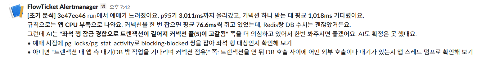

# IMP-052 · 장애 초기 분석 4차 평가(로컬): AI 출력 v5(의심 원인 순위·확인 방법) 72회, 사람 확인이 필요한 run의 Slack 알림

- 슬라이스: `S10`(부하·확장)
- 날짜: 2026-10-28(로컬 실험실 `infra/triage-lab`, 결과 `artifacts/triage-lab/eval5/`, 레포 밖)
- 유형: 평가(로컬 실측, 유효 run 72회). 같은 로컬 환경 안의 비교다.
- 관련: [[IMP-051]](3차 평가), [[ADR-029]](AI를 쓰는 범위, 결정 10 추가), `scripts/triage/`(analyze.mjs·verify.mjs·triage.mjs·notify.mjs)
- 벤치 파일: 레포 밖 `artifacts/triage-lab/eval5/`: 사전 등록 `prereg-eval5.md`, 실행 순서 `plan.txt`(시드 202610285), 측정 기록 `runs.txt`·`warmup.txt`, 채점 결과 `result/`(Haiku 5.5), 집계 `analysis.txt`·`inspect.txt`, 사후 분석 `disk-split.txt`, Slack 메시지 미리 보기 `slack-preview.txt`

## 1. 상황 (Context)
3차 평가([[IMP-051]])에서 AI(프롬프트 v4)는 규칙이 모르는 장애 run에서 원인을 단정하지 않고 "판단 불가"로 답했다. 사람이 장애를 볼 때는 확정하지 못해도 의심 원인과 이유, 확인할 방법을 먼저 적는다. AI 답도 같은 모양이 되도록 출력 형식을 바꿨다(v5).

3차 평가는 알려진 장애가 18회라 규칙과 AI의 차이를 가르기 어려웠다. 이번에는 같은 설계로 사례를 72회로 늘려 v5를 새 run으로 쟀다. 결과를 본 뒤 사람 확인이 필요한 run을 Slack으로 받도록 붙였다.

## 2. 문제 정의 + 분류
- 계층: 운영 도구(분석). 서비스 코드와 무관하다.
- 질문 1: 알려진 장애 48회·정상 12회에서 AI(v5 1순위 의심 원인)와 규칙은 각각 원인을 얼마나 맞히는가. 정상 run을 원인으로 잘못 판정하지 않는가.
- 질문 2: v5 형식이 지켜지는가. 이상으로 판정한 run에 의심 원인이 비어 있지 않은가. 근거 수치 대조 실패는 몇 회인가.
- 질문 3: 규칙이 모르는 장애 dbnet(api와 PostgreSQL 사이 네트워크 지연) 12회에서 사람 확인 표시는 몇 회 붙는가. AI가 의심 원인에서 앱과 DB 사이 경로 지연을 언급하는가.

## 3. 바꾼 것 (측정 전 고정, 커밋 986ad4f0)
- AI 출력 형식 v5(`analyze.mjs`, 프롬프트 `triage-prompt/v5`):
  - 판정은 이상·정상 둘이다. 이상이면 의심 원인을 1~3순위로 반드시 적는다. 각각 범주(redis·db·app_cpu·other), 이름, 확신도, 이유, 확인 방법을 단다.
  - 세 범주에 맞지 않는 원인은 other로 두고 이름을 직접 쓴다.
  - 근거가 부족하면 결론 상태를 "확정 못 함"으로 두고, 이때도 의심 원인을 적는다.
  - 한 줄 요약을 적는다. 근거·반대 지표·확인하지 못한 데이터·다음에 확인할 것은 v4와 같다.
- 대조(`verify.mjs`): 이상인데 의심 원인이 없거나, other인데 이름이 없으면 실패로 처리한다.
- AI 판정은 1순위 의심 원인이다(`finalVerdict`). 대조에 실패하면 판단 불가다.
- 그대로인 것: 규칙(`rules.mjs`), 요약(`normalize.mjs`), 파이프라인 최종 판정(규칙 기준, AI 1순위가 다르면 사람 확인 표시), 모델 Haiku 5.5, 필드 설명과 정상 기준(`idle_in_tx_mean` 설명 포함), 장애 주입 값.
- v5는 3차 평가 run 30회를 다시 채점해 형식이 동작하는지만 확인하고 고정했다. 그 30회는 이번 평가에 쓰지 않았다.

## 4. 측정 방법
- 판정 기준은 측정 전에 등록했다(`prereg-eval5.md`, 2026-10-28 13:55:44).
- 계획: redis·db·cpu × 강도 1·2 × 8회 = 48회, 정상 12회, dbnet × 강도 1·2 × 6회 = 12회. 합계 72회, 실행 순서는 무작위(시드 고정). 주입 값은 3차와 같다(redis 30·60ms, db 0.05·0.03코어, cpu 0.4·0.25코어, dbnet 3·10ms).
- 실험실 공연을 260개로 늘렸다(시드 멱등, 기존 공연·사용자 그대로).
- 예열 run 1회(유효) 뒤 시작했다. run마다 직전에 디스크 확인(10초 프로브 중앙값 5ms 이하)을 통과한 뒤 시작했다.
- 채점(`eval.mjs`): AI는 유효 run 전부에 불렀다(AI 단독). 같은 요약으로 규칙·파이프라인을 함께 판정했다. dbnet은 가장 가까운 범주를 db로 둔다(3차와 같음).

측정 경과(`runs.txt`, 14:00~17:14): 72칸 모두 유효 run을 얻었다. 무효였던 6회는 사전 등록 규칙대로 다시 찍었다.
- 디스크 프로브 중앙값 기준 초과 3회, 예매 결과 0건 1회(측정 환경 사유, 상한 없이 재측정)
- api 누적 지표 구간 부족 1회, PostgreSQL 표본 부족 1회(같은 조건 재측정)

## 5. 결과 (로컬 실측)

### 5.1 알려진 장애 48회·정상 12회

| | 규칙 분류기 | AI(Haiku 5.5, v5 1순위) | 파이프라인 |
|---|---|---|---|
| 장애 정답 | 47 / 48 | 40 / 48 | 47 / 48 |
| 장애 판단 불가 | 0 | 2(대조 실패) | 0 |
| 정상 run 오탐(원인으로 판정) | 1 / 12 | 1 / 12 | 1 / 12 |

| 유형·강도(각 8회, 정상 12회) | 규칙 | AI |
|---|---|---|
| redis 1(30ms) | 8 | 5 |
| redis 2(60ms) | 8 | 8 |
| db 1(0.05코어) | 8 | 6 |
| db 2(0.03코어) | 8 | 8 |
| cpu 1(0.4코어) | 7 | 6 |
| cpu 2(0.25코어) | 8 | 7 |
| 정상 | 11 | 11 |

- **질문 1(사전 등록): 규칙 우세.** 장애 정답 차이 7건(규칙 47, AI 40), 정상 오탐은 둘 다 1이다.
- AI가 맞히지 못한 8회:
  - redis 1 세 회: 두 회는 1순위를 WAL 동기화·디스크 지연(db), 한 회는 CPU 할당량(app_cpu)으로 냈다.
  - db 1 두 회: 한 회는 1순위가 "호스트 디스크 fsync 지연으로 인한 WAL 동기화 병목"(other), 한 회는 대조 실패(5.2).
  - cpu 1 두 회: 정상으로 봤다. 두 run 모두 예매 p95가 916·991ms로 이상 기준 아래이고, 할당량에 막힌 주기 비율(0.22·0.30)로 규칙만 원인을 낸 run이다.
  - cpu 2 한 회: 대조 실패(5.2).
- 규칙이 맞히지 못한 2회: cpu 1 한 회(47172341)와 정상 한 회(6a2097a4)를 db로 냈다. 두 run 모두 PostgreSQL 활성 세션 평균이 1.45·1.0으로 기준 0.5를 넘었고, 디스크 프로브 fdatasync p95가 279·236ms였다. AI도 정상 run 6a2097a4를 db로 냈다.

### 5.2 v5 형식 (질문 2)
- 이상으로 판정하고 의심 원인이 빈 run이 1회(c800a5c2) 있어 사전 등록 기준 "형식 요건 충족"에 들지 않는다.
  - 답을 열어 보면 모델이 의심 원인 목록을 `hypotheses` 필드가 아니라 `summary_line` 문자열 안에 도구 인자 태그(`</summary_line>`, `<parameter name="hypotheses">`)째 써 넣었다.
  - 같은 모양(문자열에 태그가 섞임)은 72회 중 3회였다. 나머지 2회는 의심 원인 필드가 채워져 있거나 정상 판정이라 v5 대조를 통과했다.
- 근거 수치 대조 실패 2회: 위 c800a5c2, 그리고 근거 값이 요약과 다른 1회(893e6282, `series[3].scrape_rtt_ms` 답 2,395, 실제 4,687).
- 이상 판정 56회의 결론 상태: 근거로 뒷받침됨 40, 확정 못 함 16. 의심 원인 수: 2개 43회, 3개 11회, 1개 1회.
- 측정 뒤 조치: 답 문자열에 도구 인자 태그가 섞이면 대조 실패로 처리한다(`verify.mjs`, 커밋 7c8ce1e3). 이 평가의 집계는 측정 전 고정한 대조로 냈다.

### 5.3 규칙이 모르는 장애 dbnet 12회 (질문 3)

| run | 강도 | 예매 p95 중앙값 | 디스크 fdatasync p95 | 규칙 | AI 1순위(범주/확신도) | 사람 확인 표시 |
|---|---|---|---|---|---|---|
| d28bbc25 | 3ms | 937ms | 4ms | 정상 | 정상 | AI 부르지 않음 |
| 853a3882 | 3ms | 961ms | 10ms | 정상 | 정상 | AI 부르지 않음 |
| d6df2527 | 3ms | 997ms | 329ms | 정상 | 정상 | AI 부르지 않음 |
| 5a6a7fbe | 3ms | 1,208ms | 150ms | 정상 | WAL 쓰기 경합(db/low) | AI 부르지 않음 |
| 41e4a013 | 3ms | 1,642ms | 123ms | app_cpu | WAL 쓰기 경합(db/medium) | 표시 |
| c6799b6b | 3ms | 4,302ms | 189ms | db | WAL 쓰기·동기화 지연(db/high) | |
| 51869ef4 | 10ms | 2,776ms | 3ms | app_cpu | 앱 내부 정지 또는 트랜잭션 내 외부 대기(other/low) | 표시 |
| 8a7e026c | 10ms | 2,917ms | 112ms | app_cpu | 커넥션 보유 중 앱 측 대기 또는 일시 정지(other/low) | 표시 |
| 3e47ee46 | 10ms | 3,011ms | 173ms | app_cpu | 좌석 행 잠금 경합(db/medium) | 표시 |
| 90bdee73 | 10ms | 6,028ms | 484ms | db | WAL 쓰기·동기화 지연(db/medium) | |
| d70daf16 | 10ms | 8,120ms | 1,170ms | db | 행 잠금 대기와 WAL 쓰기 경합(db/medium) | |
| a38fde98 | 10ms | 9,935ms | 922ms | db | 호스트 디스크 fsync → WAL 동기화 지연(other/medium) | 표시 |

- **표시(사전 등록): 표시 기여 유지.** 규칙이 원인을 낸 8회 중 5회가 표시됐다(절반 이상). 규칙이 db가 아닌 원인을 낸 4회는 4회 모두 표시됐다.
- **경로 지연 언급(사전 등록 낱말): 0 / 12.** 1~3순위 이름·이유에 네트워크·왕복·RTT·레이턴시·network·round-trip·latency가 한 번도 나오지 않았다.
  - AI가 낸 의심 원인 이름은 WAL·디스크 지연(1순위 6회), 행 잠금 경합(1~3순위 5회, 1순위 2회), 앱 내부 정지·대기(1~3순위 3회, 1순위 2회)였다.
  - 같은 낱말은 알려진 장애 48회 중 10회, 정상 12회 중 1회에 나왔다. 11회 중 10회는 입력 필드 이름 `scrape_rtt_ms`의 "rtt"였고, 원인으로 "네트워크"를 적은 것은 redis 2 한 회(앱과 Redis 사이 클라이언트 측 지연)였다.
- 채점 범주로는 dbnet "정답"(db)이 규칙 4회, AI 6회다. 이 run들은 모두 디스크 꼬리 지연이 함께 있었다(5.4).
- dbnet은 강도별 6회라 차이는 우연과 구분되지 않을 수 있다.

### 5.4 사후 분석: 디스크 꼬리 지연과 함께 본 정답 (사전 등록 밖)
측정 유효성은 디스크 프로브 fdatasync **중앙값**(10ms 이하)으로 가른다. 꼬리(p95)는 run마다 2~1,705ms(중앙값 134ms)로 흔들렸다. p95 100ms로 나눠 세면 다음과 같다(같은 결과 파일로 다시 센 값).

| 묶음 | 디스크 p95 < 100ms | 디스크 p95 ≥ 100ms |
|---|---|---|
| 알려진 장애: run 수 | 23 | 25 |
| 알려진 장애: 규칙 정답 | 23 | 24 |
| 알려진 장애: AI 정답 | 21 | 19 |
| 정상: run 수 / 규칙·AI 오탐 | 7 / 0·0 | 5 / 1·1 |
| dbnet: run 수 / 규칙 db·AI db | 3 / 0·0 | 9 / 4·6 |

- AI가 맞히지 못한 알려진 장애 8회 중 6회, 규칙·AI의 정상 오탐 1회가 디스크 꼬리 지연 run에 있다.
- 디스크 꼬리 지연이 있던 run에서 AI는 WAL 동기화·디스크 지연을 1순위로 자주 냈다. 이 run들의 WAL 동기화 평균은 실제로 정상 상한(16.98ms)보다 높았다(예: redis 1 d766df1f 31.13ms, a785b92b 32.82ms). AI가 주입한 장애와 측정 환경의 디스크 지연이 겹친 run에서 디스크 쪽을 고른 것으로 본다(추론).
- dbnet의 db 판정은 디스크 꼬리 지연 run에서만 나왔다. 디스크가 조용한 dbnet 3회에서는 규칙·AI 모두 db를 내지 않았다. dbnet의 db 판정은 네트워크 지연을 알아본 결과가 아니라 디스크 지연을 본 결과일 가능성이 크다(추론).

### 5.5 표시의 비용
- 알려진 장애에서 규칙이 맞힌 47회 중 6회가 표시됐다(헛표시). 규칙이 틀린 2회 중 1회(47172341, AI 1순위 app_cpu)가 표시됐다.
- 72회 전체에서 표시는 12회였다(dbnet 5회, 알려진 장애 7회).

### 5.6 비용
AI 호출 72회의 평균 토큰은 입력 4,806·출력 3,556이고, 비용은 합계 약 $0.163(호출당 약 $0.0023)이다(공개 단가로 계산). 72회 채점에 약 19분이 걸렸다.

### 5.7 이전 평가 대비(참고)
서로 다른 run 묶음의 비교라 사전 등록대로 참고로만 적는다.
- 3차(v4, 알려진 장애 18회)는 규칙·AI 모두 18/18이었다. 이번(v5, 48회)은 규칙 47/48, AI 40/48이다.
- 3차의 dbnet 10ms 3회에서 AI는 판단 불가였고, 이번 10ms 6회에서는 모두 의심 원인을 1순위로 냈다(db 3·other 3).

## 6. 조치
- 출력 형식 v5를 채택한다. 이상 판정에는 의심 원인 1~3순위와 이유, 확인 방법이 붙는다. 답 문자열에 도구 인자 태그가 섞이면 대조 실패로 처리한다.
- 최종 판정은 규칙 기준으로 유지한다([[ADR-029]] 결정 9). 이번 평가에서 원인 판정은 규칙이 더 맞혔다(5.1).
- 사람 확인 표시가 붙은 run만 Slack으로 알린다([[ADR-029]] 결정 10, `scripts/triage/notify.mjs`).
  - 메시지는 템플릿으로 조립한다. 수치는 요약 JSON 값을 그대로 넣고, AI 답에서는 1순위·2순위 원인 이름과 확인 방법 첫 문장만 가져온다.
  - 웹훅 URL은 환경변수(`TRIAGE_SLACK_WEBHOOK_URL`)로만 받고 `hooks.slack.com` 주소가 아니면 보내지 않는다. 기본은 미리 보기이고, `--send`(또는 `triage.mjs --slack`)일 때만 보낸다.
  - 기존 Alertmanager 웹훅(SSM `/flowticket/SLACK_ALERT_WEBHOOK_URL`)으로 3e47ee46 메시지를 보내 채널 표시를 확인했다.

- 규칙, 원인 범주, 필드 설명(`idle_in_tx_mean` 포함), 모델은 그대로 둔다.

## 7. 트레이드오프 / 다음 개선
- 헛표시: 규칙이 맞힌 알려진 장애 47회 중 6회가 표시됐다. Slack으로 받는 메시지 중 일부는 규칙 판정이 맞은 run이다.
- 규칙이 정상으로 본 run은 AI를 부르지 않아 Slack에도 오지 않는다. dbnet 3ms 4회가 그랬다.
- 디스크 꼬리 지연: 측정 유효성은 프로브 중앙값으로만 가른다. 꼬리 지연이 큰 run이 절반쯤 유효로 들어왔고, AI 오답과 정상 오탐이 그쪽에 몰렸다(5.4). 다음 평가는 꼬리 지연을 유효성 조건에 넣을지 먼저 정하고 잰다.
- 경로 지연: AI는 dbnet에서 네트워크 경로를 한 번도 의심 원인으로 적지 않았다. 프롬프트의 `idle_in_tx_mean` 설명("트랜잭션 안에서 앱 쪽 작업을 기다리는 세션")이 앱 쪽 원인으로 이끌었을 수 있다(추측). 설명을 바꾸면 새 평가 run으로 다시 잰다.
- 측정 조건: 로컬 상대 비교다. 장애는 하나씩만 주입했다.

## 8. 배운 점 (면접 답변용 한 줄)
AI가 "판단 불가" 대신 사람처럼 의심 원인과 확인 방법을 내도록 출력 형식을 바꾸고 72회로 다시 쟀다. 원인 판정은 규칙이 47/48로 AI(40/48)보다 정확해 최종 판정은 규칙에 두고, 규칙과 AI가 갈린 run만 의심 원인과 확인 방법을 붙여 Slack으로 보내도록 했다.
